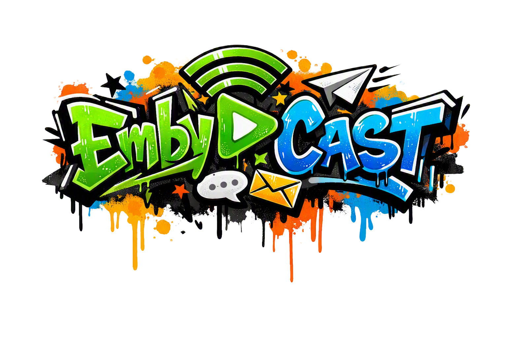

# EmbyCast

An Emby Server plugin that lets admins send instant, scheduled, countdown/timer, media-news,
welcome and system messages to users and admins from a single dashboard page — with a full
English/German UI and a built-in self-updater.



## Features

- **Tile dashboard** — every function has its own tile. Drag tiles into your preferred order;
  status dots show at a glance what is switched on. Colour schemes (colourful, Emby accent colour,
  neutral, pastel) plus individual tile colours.
- **Instant messages** to active users, all users, or selected users & groups — shown as a
  dialog or as a short pop-up.
- **Scheduled messages** — set a date/time, delivered automatically in the background; pending
  messages can be edited or cancelled.
- **Countdown/timer** broadcasts with reminders at chosen minute marks, an optional server
  restart/shutdown when it ends, and an optional delayed start.
- **Media news** — auto-generated "what's new" digests from your libraries, sendable on demand
  or on a weekly schedule. Each recipient only sees titles from libraries they have access to.
  Optionally sent to web-browser sessions only.
- **Welcome message** for first-time logins.
- **System Message** — Emby server events (logins, failed logins, playback, new media, failed
  scheduled tasks, plugin updates, backups and more) as a dialog or short pop-up on the active
  sessions of the administrators you choose. User events can be limited to selected users &
  groups; admins are not told about their own actions (except failed logins and lock-outs of
  their account). Works without Emby Premiere and also shows notifications that Sonarr/Radarr
  send to Emby (see below).
- **Offline delivery** — messages for users who are not online are kept and delivered at their
  next login. Can be switched off; kept messages expire after a configurable number of days.
  Countdown and system messages are never kept.
- **User groups** — save named, reusable recipient groups from your user list, then pick them
  alongside individual users anywhere recipients are selected. Membership is resolved at send
  time, so editing a group later also applies to any already-created scheduled message or timer
  that still references it.
- **Status & history** view of every sent message with per-user delivery status (delivered,
  pending, failed, expired).
- **Scheduled cleanup** — undelivered messages and old history entries are removed
  automatically. Users deleted in Emby are also removed from groups, schedules and recipients.
- **Settings** — how much EmbyCast writes to the Emby server log, offline delivery on/off, beta
  versions on/off and the tile colours.
- **Self-update** — checks GitHub Releases for a newer version, shows its release notes right in
  the dashboard and installs it with one click, after verifying its checksum and release
  signature. Optionally also offers beta versions (pre-releases); a newer stable version is
  always offered.

### Sonarr / Radarr notifications

Sonarr and Radarr can send their notifications through Emby, and EmbyCast can show them:

1. In Sonarr/Radarr: **Settings → Connect → + → Emby / Jellyfin**, enter your Emby host, port
   and an Emby API key, and enable **Send Notifications**.
2. In EmbyCast: **System Message → New System Message**, tick the event **External** and
   choose the administrators who should see them.

Note: Radarr does not send "movie added" to Emby, and sends "movie deleted" only when files are
deleted.

## Credits

Built using the same SDK patterns as **EmbyNotify** and **EmbyWeeklyDigest**, two plugins created
by **[SFTech13](https://github.com/sftech13)**, which served as the architectural template for
this project. This project is not affiliated with SFTech13.

## Requirements

Emby Server **4.9.5 or newer** (.NET 8). Tested up to 4.11.0.13 beta.

## Installation

1. Download `EmbyCast.Plugin.dll` from the [Releases](../../releases) page.
2. Copy it into your Emby Server `plugins` folder (e.g. `%ProgramData%\Emby-Server\plugins` on
   Windows, `/var/lib/emby/plugins` on Linux).
3. Restart Emby Server.
4. Go to **Dashboard → Plugins**, open "EmbyCast", and configure it.

### Upgrading from v1.2.7 or older

After updating to v1.3.0, clear the browser cache once (or do a hard reload of the dashboard
page). From then on, the dashboard always loads the version that matches the installed plugin -
no more cache clearing after updates.

## Building from source

```
cd EmbyCast.Plugin
dotnet restore
dotnet build -c Release
```

Requires the .NET SDK. The project targets **netstandard2.0** on purpose — do not change this,
Emby Server's plugin loader expects netstandard2.0 assemblies.

The build output goes to `artifacts/bin/Release/netstandard2.0/EmbyCast.Plugin.dll` (set by
`Directory.Build.props` in the repository root).

## Publishing a release (for self-update)

Before installing an update, the dashboard's "Install Update" button checks two things:

1. **Checksum** — the downloaded DLL must match the SHA-256 digest GitHub computes automatically
   for every uploaded release asset. This catches corrupted or incomplete downloads.
2. **Signature** — the DLL must carry a valid RSA signature (`EmbyCast.Plugin.dll.sig`) made with
   the maintainer's private release key. The matching public key is compiled into the plugin
   (`ReleaseSignature.cs`). Because the private key is never stored in the repository or on GitHub,
   this also protects against a compromised GitHub account: a tampered DLL can't be signed.

An update that fails either check is refused, never installed.

### Release steps

1. Bump `<VersionPrefix>` in `EmbyCast.Plugin/EmbyCast.Plugin.csproj`.
2. Build: `dotnet build -c Release` (see above).
3. Sign the built DLL with the private key:

   ```
   powershell -ExecutionPolicy Bypass -File EmbyCast.Plugin/tools/sign-release.ps1 ^
     -DllPath artifacts/bin/Release/netstandard2.0/EmbyCast.Plugin.dll ^
     -PrivateKeyPath <path to your private key .xml>
   ```

   This creates `EmbyCast.Plugin.dll.sig` next to the DLL. Do not rebuild after signing — the
   signature would no longer match.
4. Create a GitHub release tagged `vX.Y.Z` and attach **both** files with exactly these names:
   `EmbyCast.Plugin.dll` and `EmbyCast.Plugin.dll.sig`.

The signature check is active from v1.2.7 on, so every later release must be signed.

### One-time key setup (maintainers only)

`tools/sign-release.ps1 -GenerateKey -PrivateKeyPath <path>` creates the key pair and prints the
public key to paste into `ReleaseSignature.cs`. Keep the private key file outside the repository
and back it up: anyone holding it can publish updates that installed copies will accept, and
losing it means existing installations can only be updated manually. If `PublicKeyModulus` is left
empty (e.g. in a fork), the signature check is disabled and only the checksum is verified.

## Uninstalling

Uninstall via *Dashboard → Advanced → Plugins*. The plugin's saved settings are removed as well,
together with its message history, groups, scheduled messages and System Messages.

## Feedback

Feedback and bug reports are welcome in the
[Emby forum thread](https://emby.media/community/topic/149231-plugin-embycast-%E2%80%93-a-multi-message-toolkit-for-your-dashboard/)
or in the [Issues](../../issues).

## License

[MIT](LICENSE) © SolisTVBox

## Built with AI assistance

Developed with the help of [Claude](https://claude.ai) (Anthropic).

## Support

If EmbyCast is useful to you, consider [buying me a coffee ☕](https://ko-fi.com/soliflix).

[](https://ko-fi.com/soliflix)
